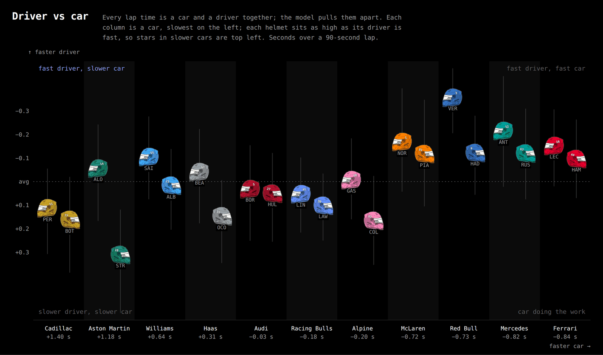
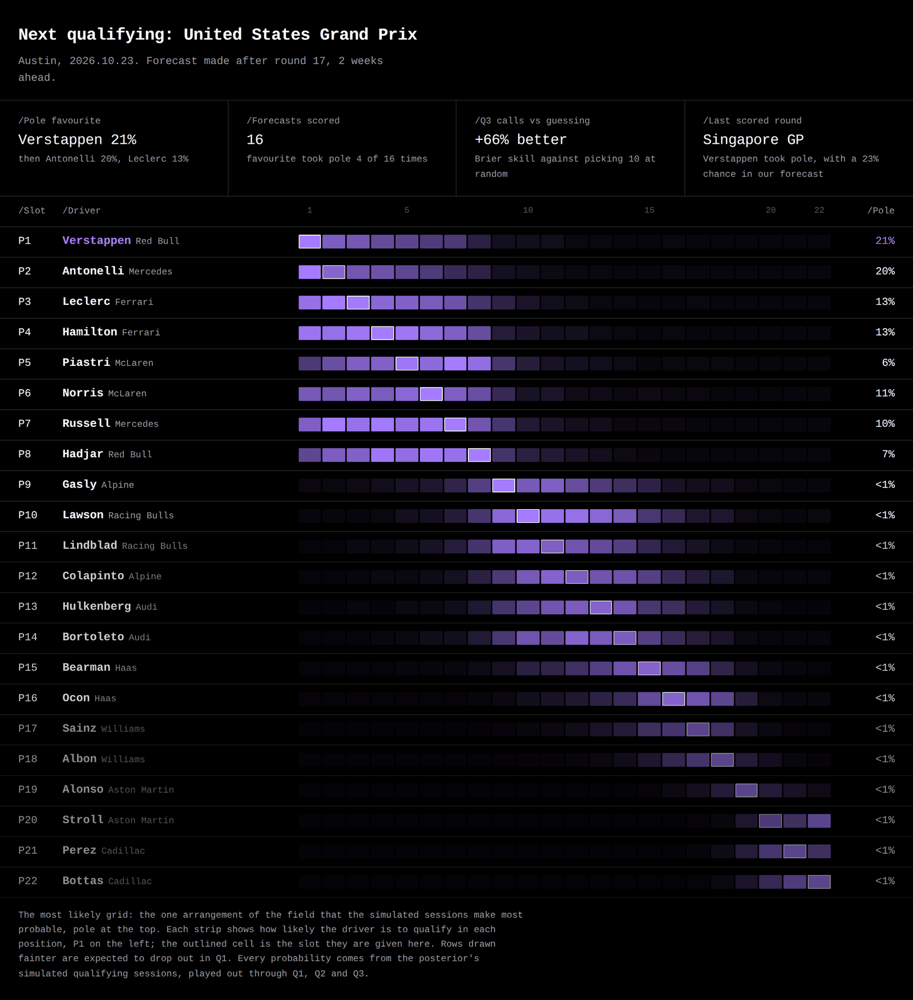
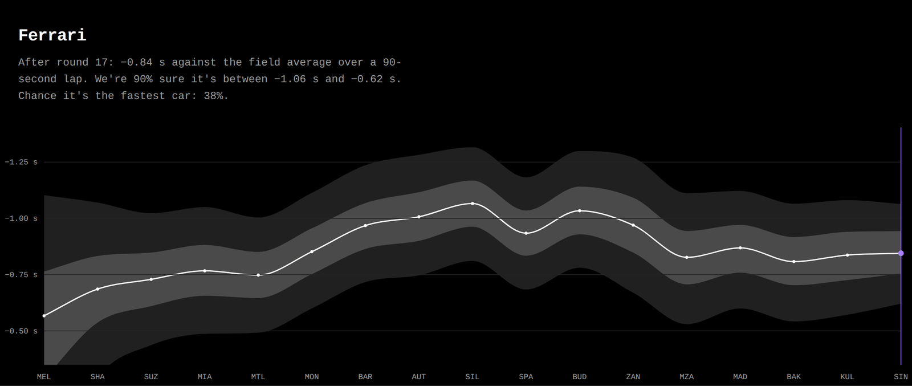
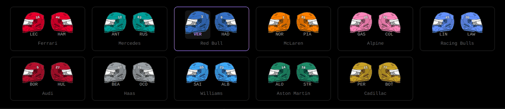

# purple-sectors

**Who is quick because of the car, and who is quick anyway.**
One Bayesian model of every Formula 1 qualifying lap since 2023, refit after every session.

**Live → [tahahaha7.github.io/purple-sectors](https://tahahaha7.github.io/purple-sectors/)**

[](https://github.com/Tahahaha7/purple-sectors/actions/workflows/update.yml)
[](https://github.com/Tahahaha7/purple-sectors/actions/workflows/pages.yml)
[](https://github.com/Tahahaha7/purple-sectors/actions/workflows/ci.yml)



Every lap time is a car and a driver together. This model pulls them apart: columns are cars,
slowest on the left; each helmet sits as high as its driver would be in an average car. Stars in
slow cars are top left. Verstappen, top right, is 0.35 s a lap quicker than an average driver in
only the third-quickest car.

## What it does that nothing else does

- **Ranks the drivers with the car removed, and the cars with the drivers removed**, from one
  posterior, with a 90% range on every number. Not points, not quali head-to-heads: pace.
- **Puts every driver in every car.** A shrunk driver × car term means the site can say where
  Hamilton would qualify in a Williams, and how unsure it is, even though he has never driven one.
- **Connects the whole grid across seasons.** Driver skill carries from year to year, so every team
  move links two garages; 2022 best laps are the bridge that ties McLaren and Aston Martin to
  everyone else. That connectivity is what makes the decomposition identifiable at all.
- **Forecasts the next grid and scores itself.** Thousands of simulated sessions, played out through
  Q1, Q2 and Q3, give a position distribution for every driver. When the real grid arrives, the
  forecast is graded and the scorecard is public.
- **Refuses to publish a bad fit.** Zero divergences, R-hat ≤ 1.01, ESS ≥ 400, or the run retries
  once and otherwise keeps the previous posterior live.
- **Replays the season.** Every round is refit from scratch (`backfill.yml`), so you can scrub
  from Melbourne to now and watch the order move.

## The site

| | |
|---|---|
|  |  |
| **Soft · the quick read.** The two rankings, every driver in every car, and the next grid as the most likely arrangement of all 22, each row a strip of where that driver could land. | **Medium · the season.** Play the season: the rankings after every round, places gained and lost, and each car's or driver's pace with its uncertainty, round by round. |



**Inter · one driver.** Pick a helmet: their ranking with the car removed, where they would qualify
in every car on the grid, and their teammate battle as a ridgeline across the season.
**Hard · the model.** Every term, every prior, every check, and the live diagnostics of the latest
fit, written as technical regulations.

## The model

```
lap = baseline(session, segment) + evolution × t + car + driver + fit(driver, car) + tyres + execution
```

in percent of lap time (1% ≈ 0.9 s on a 90-second lap). **car** is a team in one season, a level
plus a random walk over the rounds. **driver** is skill relative to the grid, carried across
seasons from a rookie offset. **fit** is the driver × car term, shrunk towards zero. **execution**
says each lap is either clean or compromised, both ex-Gaussian, so one ruined Q1 does not drag a
driver's estimate down. Specification, identification, priors, checks and limits:
[`docs/pace_model.md`](docs/pace_model.md).

## The pipeline

Sunday 06:00 UTC, Monday retry if timing data was late:

```
OpenF1 + Jolpica → fetch → stan/pace.stan (CmdStan) → checks → export site/data → forecast → commit → Pages
```

```
src/purple_sectors/
  fetch.py           OpenF1 → data/raw/quali_laps_<year>.csv
  history.py         Jolpica → 2022–25 best laps, debuts, teammate network
  rollover.py        end-of-season archive (docs/rollover.md)
  pace/data.py       laps → design
  pace/fit.py        fit, checks, posterior
  pace/export.py     posterior → site/data (soft, pace grid, snapshots)
  pace/forecast.py   next session and the scorecard
  pace/simulate.py   NumPy mirror of the Stan model for prior checks and recovery
stan/pace.stan       the model
site/                static site, no build step
notebooks/           the whole pipeline in one Colab
tests/               pytest, no network or CmdStan needed
```

<details>
<summary>Reproduce</summary>

```bash
pip install -r requirements.txt
export PYTHONPATH=src
for y in 2023 2024 2025 2026; do python -m purple_sectors.fetch --year $y; done
python -m purple_sectors.pace.fit --years 2023 2024 2025 2026 --out posterior_pace.npz --report fit.json --retry
python -m purple_sectors.pace.export --posterior posterior_pace.npz --laps data/raw/quali_laps_2026.csv \
    --out site/data --snapshot-dir site/data/snapshots
pip install -r requirements-dev.txt && pytest
```

</details>

Lap timing from [OpenF1](https://openf1.org); history from [Jolpica](https://jolpi.ca). MIT licence.
An independent fan project, not associated with Formula 1.
