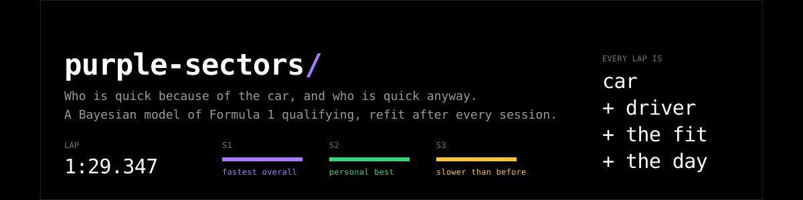
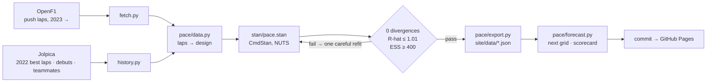

<p align="center"></p>

<p align="center">
<a href="https://github.com/Tahahaha7/purple-sectors/actions/workflows/update.yml"></a>
<a href="https://github.com/Tahahaha7/purple-sectors/actions/workflows/pages.yml"></a>
<a href="https://github.com/Tahahaha7/purple-sectors/actions/workflows/ci.yml"></a>
</p>

<h3 align="center"><a href="https://tahahaha7.github.io/purple-sectors/">tahahaha7.github.io/purple-sectors</a></h3>

---

In Formula 1 timing, a **purple sector** is the fastest anyone has gone. It is also the hardest
thing to read on a timing screen, because every lap time is two things at once: the car and the
person driving it. Lewis Hamilton in a Ferrari is not Lewis Hamilton in a Mercedes, and a
rookie in the quickest car will out-qualify a champion in the slowest.

This project fits **one Bayesian model to every qualifying push lap since 2023** and pulls the two
apart. After every session it answers three questions, with honest uncertainty on each:

| | Question | Where |
|---|---|---|
| **1** | Which **driver** is quickest, with the car taken away? | Soft |
| **2** | Which **car** is quickest, with the driver taken away? | Soft |
| **3** | Where would **driver X qualify in car Y**, including cars he has never driven? | Soft, Inter |

…and then it forecasts the next grid, scores itself when the real one arrives, and refits.

> After round 17 (Singapore), the model has seen 1,729 push laps this season. It puts Verstappen
> at **0.35 s a lap quicker than an average driver**, in a car that is only the third quickest,
> and Ferrari as the quickest car. That is the kind of sentence the site rewrites every Sunday.

## Four pages, like four compounds

The site is organised the way a race weekend is: by how deep you want to go.

| Page | For | What it shows |
|---|---|---|
| **Soft** | the quick read | the two rankings, every driver in every car, the next grid as the model expects it |
| **Medium** | the season | the same rankings after every round, as a replay; how the order moved and why |
| **Inter** | one driver | pick a helmet: ranking, where they would qualify in every car, the teammate battle round by round |
| **Hard** | the model | every term, every prior, every check, and the live diagnostics of the latest fit |

## The model, in one line

```
lap = baseline(session, segment) + evolution × t + car + driver + fit(driver, car) + tyres + execution
```

Units are percent of lap time; 1% is about 0.9 s on a 90-second lap.

- **car** is a team in one season: a persistent level plus a random walk over the rounds, so a car
  can be developed into the season or fall away.
- **driver** is skill relative to the grid, carried **across seasons**. That is what makes the
  decomposition possible: a driver who changes team links two garages, and every driver has moved,
  or had a teammate who moved, so the whole grid is connected. 2022 best laps are the bridge that
  ties McLaren and Aston Martin to everyone else.
- **fit** is a shrunk driver-by-car term. Pairs that happened are learned; pairs that never happened
  get the prior, which is exactly what lets the site put a driver in a car he has not driven and
  say how unsure it is.
- **execution** admits that laps go wrong: each lap is either clean or compromised, both ex-Gaussian,
  so one bad Q1 does not drag a driver's whole estimate down.

Full specification, identification argument, priors, limits and the checks the fit must pass:
[`docs/pace_model.md`](docs/pace_model.md).

## The pipeline

Every Sunday at 06:00 UTC, with a Monday retry in case timing data is late:



A fit that fails its checks is not published; the previous posterior stays live and the run is
marked. `backfill.yml` replays the season round by round (fit rounds 1..k for every k), which is
what Medium and Inter scrub through.

```
src/purple_sectors/
  fetch.py           OpenF1 → data/raw/quali_laps_<year>.csv   rate-limited, cached per session
  history.py         Jolpica → 2022–25 best laps, debuts, the teammate network
  rollover.py        end-of-season archive                      docs/rollover.md
  pace/data.py       laps → design matrices
  pace/fit.py        CmdStan fit, checks, posterior file
  pace/export.py     posterior → site/data  (soft, pace grid, snapshots)
  pace/forecast.py   the next qualifying session, and how the last forecast did
  pace/simulate.py   NumPy mirror of the Stan model: prior checks, parameter recovery
stan/pace.stan       the model
site/                the static site, no build step
notebooks/           the whole pipeline in one Colab, with the recovery check
tests/               pytest · 23 tests · no network or CmdStan needed
```

## What it does not do

Race pace, strategy, tyre degradation over a stint, how long a driver would need to adapt to a
different car, or anything about the weather. It is a model of a single flying lap in qualifying,
and it says so when you ask it something else.

<details>
<summary><b>Reproduce the fit</b></summary>

```bash
pip install -r requirements.txt
export PYTHONPATH=src
for y in 2023 2024 2025 2026; do python -m purple_sectors.fetch --year $y; done
python -m purple_sectors.pace.fit --years 2023 2024 2025 2026 \
    --out posterior_pace.npz --report fit.json --retry
python -m purple_sectors.pace.export --posterior posterior_pace.npz \
    --laps data/raw/quali_laps_2026.csv --out site/data --snapshot-dir site/data/snapshots
```

CmdStan is needed for the fit; the fetch, export and site run anywhere. The fit takes a few
minutes on a laptop.

</details>

<details>
<summary><b>Run the tests</b></summary>

```bash
pip install -r requirements-dev.txt
pytest          # a few seconds, no network
```

</details>

---

Lap timing from [OpenF1](https://openf1.org); history, debuts and teammate pairings from
[Jolpica](https://jolpi.ca). MIT licence. An independent fan project, not associated with
Formula 1.
